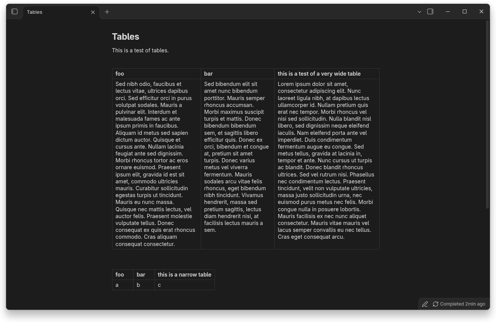
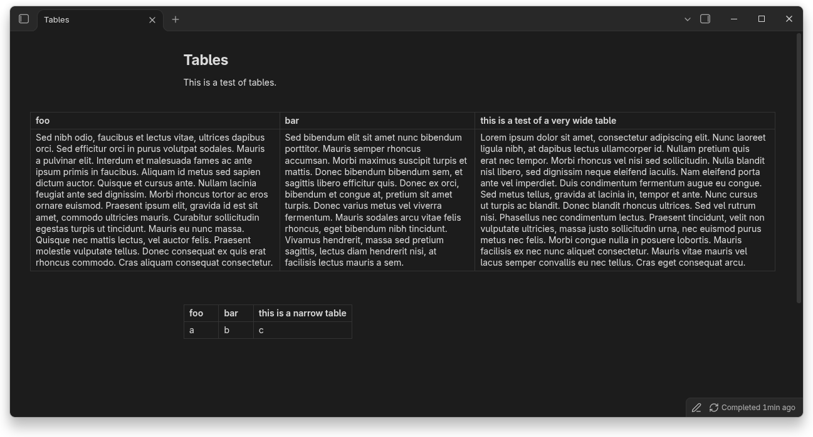
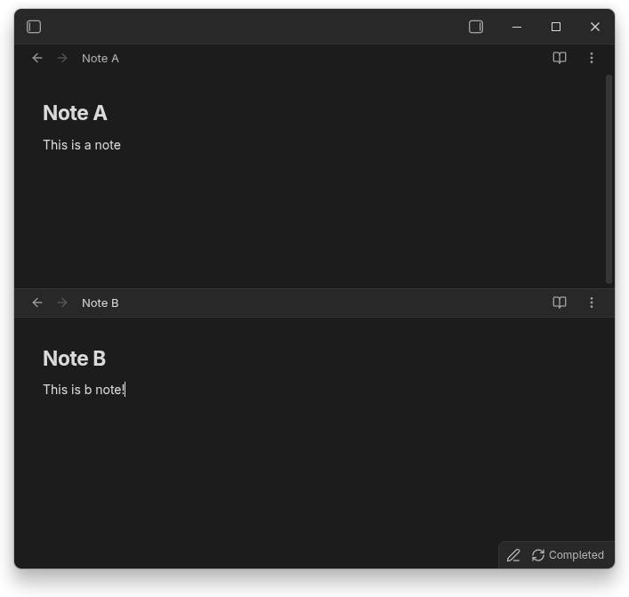

# Obsidian Snippets
The CSS snippets that I often use in obsidian.

## `wide-tables.css`
Remove the line width limit from tables, while keeping it for everything else.
Narrow tables are left unchanged.
Now when you have a lot of text in a table, you can just maximise your window and all is visible.

_Before:_

_After:_

## `hide-tabs.css`
Hide tabs in the title bar, and remove tab bars of additional tab groups (or "panes" as I would call them).
This snippet is opinionated: I don't use tabs.
I like to split my panes like in vim, and the tab bars take up a lot of room.

The currently focussed tab has its tab title bar highlighted.

**Note: turn on the setting _Interface > Show tab title bar_**

## `less-nav-padding.css`
This just slightly decreases the horizontal padding in the navigation pane, to take up a bit less room.

## `nightfox.css`
This is the [Nightfox theme](https://github.com/markmacode/obsidian-nightfox) but with **only the colour changes**, and no changes to font sizes etc.
